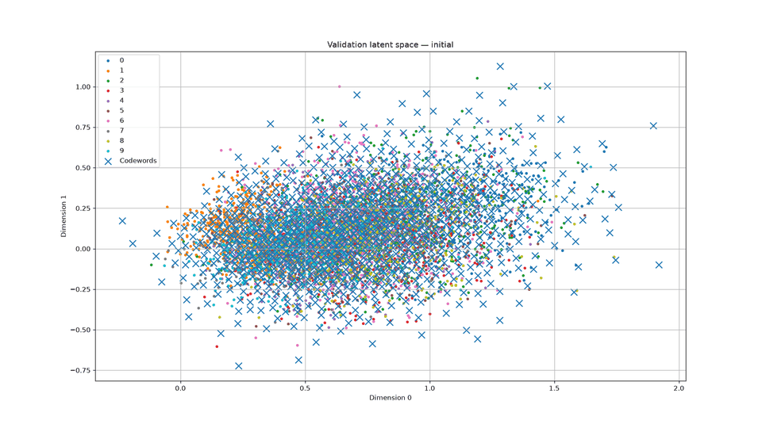
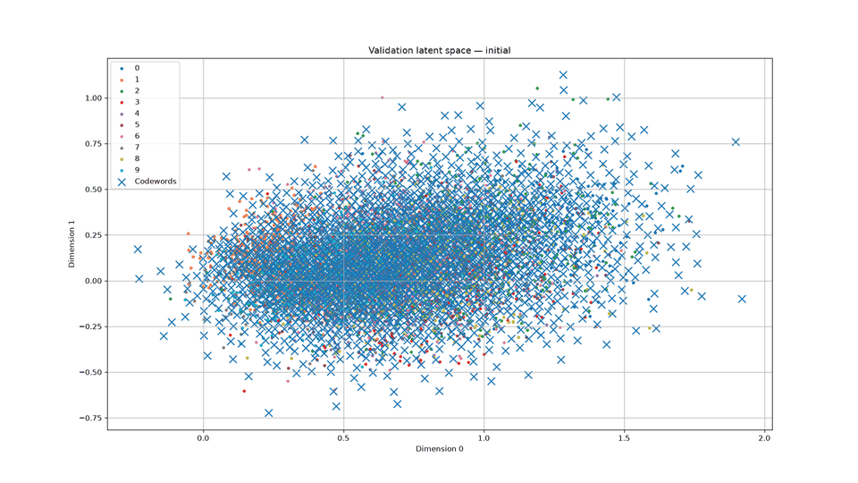

# Statistical Quantization for VQ-VAE

A PyTorch-based research project investigating vector quantization and statistical codebooks in Variational Autoencoders (VQ-VAE).

The project focuses on discrete latent representations, statistical codebook modelling, and the empirical relationship between reconstruction quality and quantization efficiency.

## Research Focus

Vector Quantized Variational Autoencoders represent continuous encoder outputs through discrete codebook entries.

This project investigates statistical extensions to conventional vector quantization, in which codebook entries can be represented by distributions rather than deterministic vectors.

The implementation includes:

- **Vector quantization:** Nearest-neighbour assignment of latent vectors to codebook entries.
- **Statistical codebooks:** Codebook entries represented by means and optional variances.
- **Exponential moving averages:** Updating codebook statistics using assignment counts and latent-vector moments.
- **K-Means initialization:** Data-driven initialization of codebook entries.
- **Stochastic quantization:** Optional sampling from statistical codebook distributions.
- **Straight-through estimation:** Gradient propagation through the discrete quantization operation.

## Quantization Analysis

The project evaluates discrete latent representations using reconstruction and codebook statistics.

| Metric | Description |
|---|---|
| Entropy | Empirical information content of codebook assignments |
| Rate | Assignment entropy measured in bits |
| Perplexity | Effective number of utilized codebook entries |
| Utilization | Fraction of active codebook entries |
| Active codewords | Number of codebook entries used |
| Dead codewords | Number of unused codebook entries |
| Distortion | Reconstruction error |

The empirical assignment entropy is calculated as

\[
H(K)=-\sum_{k=1}^{M}p_k\log_2(p_k),
\]

where \(p_k\) denotes the empirical probability of assigning a latent vector to codebook entry \(k\).

Perplexity is defined as

\[
\operatorname{Perplexity}=2^{H(K)},
\]

and codebook utilization as

\[
\operatorname{Utilization}
=\frac{\text{Number of active codewords}}{M}.
\]

Together with reconstruction distortion, these measurements enable an empirical investigation of rate-distortion trade-offs in discrete latent representations.

## Selected Visualizations

The following visualizations illustrate the learned validation latent spaces for different codebook cardinalities.

### Codebook cardinality: 1,024



### Codebook cardinality: 2,048



These visualizations are intended to illustrate the evolution of latent representations and codebook entries during training. They should be interpreted alongside the quantitative codebook and reconstruction metrics.

- **Generated samples:** [View generated samples (PDF)](docs/figures/samples.pdf) — outputs from the generative experiment.

## Experimental Setup

The implementation supports:

- MNIST
- CIFAR-10

The dataset preparation pipeline creates training, validation, and test loaders. The validation subset is sampled deterministically from the official training partition, while the official test partition remains untouched.

The model and experiment configuration support different latent dimensions, codebook cardinalities, training parameters, and codebook update strategies.

Statistical variance modelling is optional. The main experiment configuration enables it explicitly.

Experimental configurations and recorded metrics are collected in `results/experiments.csv`.

## Project Structure

```text
.
├── classes/             # VQ-VAE components and training utilities
├── data_preprocessing/  # Dataset preparation and splitting
├── tests/               # Automated test suite
├── docs/
│   └── figures/         # Selected research visualizations
├── results/             # Experimental records and generated outputs
├── checkpoints/         # Model checkpoints (not version-controlled)
├── data/                # Downloaded datasets (not version-controlled)
├── main.py              # Main experiment entry point
├── settings.py          # Experiment configuration
├── model.py             # Model construction
├── objective.py         # Training objective
├── training.py          # Training utilities
├── evaluation.py        # Validation and test evaluation
├── experiment_results.py
├── pyproject.toml
├── requirements.txt
├── requirements-dev.txt
└── requirements-torch-cu132.txt
```

## Installation

Python 3.12 or newer is required.

### 1. Clone the repository

```bash
git clone <repository-url>
cd statistical-quantization-vqvae
```

### 2. Create a virtual environment

Windows PowerShell:

```powershell
python -m venv .venv
.venv\Scripts\Activate.ps1
```

### 3. Install PyTorch

Install PyTorch and torchvision using the appropriate configuration for your hardware.

For the tested CUDA 13.2 configuration:

```powershell
python -m pip install -r requirements-torch-cu132.txt
```

For other CUDA configurations or CPU-only installations, use the corresponding installation command from the official PyTorch installation selector.

### 4. Install project dependencies

```powershell
python -m pip install -r requirements-dev.txt
```

## Running Experiments

The main experiment is launched from the project root:

```powershell
python main.py
```

The current `main.py` configuration specifies:

| Parameter | Value |
|---|---:|
| Dataset | MNIST |
| Epochs | 20 |
| Latent dimension | 2 |
| Codebook cardinality | 1,024 |
| EMA | Enabled |
| Statistical variance modelling | Enabled |
| Commitment coefficient | 1.0 |
| Training batch size | 256 |
| Validation fraction | 0.20 |
| Learning rate | 0.001 |

The program automatically selects CUDA when available and otherwise uses the CPU.

MNIST and CIFAR-10 are downloaded automatically when required. Dataset files are stored in `data/`.

### Selecting CIFAR-10

The default experiment uses MNIST.

To run the experiment with CIFAR-10, enable the corresponding setting in the `VQVAEExperimentSettings` construction inside `main()`:

```python
use_cifar10=True,
```

### Test-set evaluation

After training and validation, the program asks whether to evaluate the selected model on the held-out test set:

```text
Evaluate the selected model on the held-out test set? [y/N]:
```

Enter `y` to perform test evaluation or press Enter to skip it.

The validation set is used for model selection. Test-set evaluation is performed separately.

## Experimental Outputs

A completed experiment produces:

- Training and validation metrics.
- Reconstruction and codebook statistics.
- A recorded experiment entry in `results/experiments.csv`.
- Model checkpoints in `checkpoints/`.
- Validation latent-space visualizations.

The experiment CSV records parameters and measurements including distortion, rate, entropy, perplexity, utilization, active codewords, and dead codewords.

## Testing

Run the automated test suite from the project root:

```powershell
pytest
```

For additional test output:

```powershell
pytest -v
```

## License

This project is licensed under the MIT License. See `LICENSE` for details.